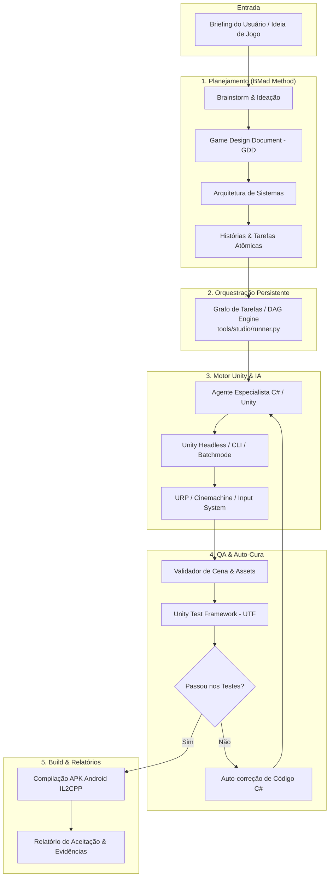

# 🎮 Autonomous Game Dev Studio (AI + Unity 6 URP + Android)

[](https://unity.com/)
[](https://docs.unity3d.com/Packages/com.unity.render-pipelines.universal@latest)
[-green?logo=android)](https://developer.android.com/)
[](https://github.com/bmad-code-org/BMAD-METHOD)
[](evidence/test-reports/junit-results.xml)
[](LICENSE)

Plataforma autônoma de desenvolvimento de jogos 3D mobile orientada por agentes de inteligência artificial. Capaz de receber um briefing em linguagem natural e conduzir o ciclo completo de produção: planejamento, arquitetura, criação de cenas no Unity, implementação de scripts C#, testes automatizados (UTF), auto-correção de falhas e compilação do APK Android com evidências determinísticas.

---

## 🚀 Capacidades do Estúdio

- **Orquestração Persistente (DAG):** Grafo de dependências entre tarefas em `.studio/tasks/`, garantindo continuidade entre sessões sem prompts redundantes.
- **Integração Nativa Unity Headless:** Controle do editor via Unity CLI oficial e scripts C# batchmode sem necessidade de interface gráfica aberta.
- **Planejamento de Jogo (BMad):** GDD automatizado, arquitetura de sistemas e decomposição em histórias pelo módulo oficial `bmad-game-dev-studio`.
- **Qualidade & Testes (TDD):** Execução do Unity Test Framework em EditMode/PlayMode. Se um teste falhar, o agente analisa o stacktrace e repara o código autonomamente.
- **Pipeline Android Automatizado:** Compilação de APKs com IL2CPP, ARM64 e otimizações mobile (URP, Dynamic Resolution, Target Frame Rate 60 FPS).
- **Inspeção Visual:** Captura e validação de screenshots diretamente pela GPU em modo headless.

---

## 🏗️ Arquitetura do Sistema



---

## 📂 Estrutura do Repositório

```text
gamedev-setup-ia/
├── .agents/skills/            # Catálogo de skills (Unity Technologies, Superpowers, BMad)
├── .opencode/                 # Comandos e MCP configurados para agentes OpenCode
├── .studio/tasks/             # Máquina de estados e tarefas do grafo de execução (DAG)
├── docs/
│   ├── standards/             # Padrões canônicos (unity.md, architecture.md, testing.md)
│   ├── art/                   # Bíblia de arte e especificações visuais
│   └── decisions/             # Architecture Decision Records (ADR-001, ADR-002)
├── evidence/
│   ├── captures/              # Screenshots de validação de cena em batchmode
│   ├── test-reports/          # Relatórios JUnit e XML de testes UTF
│   └── qa-report.md           # Relatório consolidado de aceitação de qualidade
├── tools/
│   ├── android/build_apk.py   # Compilador autônomo de APK Android
│   ├── qa/generate_report.py  # Gerador de relatórios de auditoria e métricas
│   ├── studio/runner.py       # Orquestrador de tarefas e persistência entre sessões
│   └── validation/            # Validadores de cenas, assets e regras do projeto
├── unity/                     # Projeto Unity 6 URP completo
│   ├── Assets/Game/           # Cenas, Scripts, Prefabs e Testes do jogo
│   └── Assets/Editor/         # Scripts de automação headless (StudioAutomation, BuildPipeline)
├── AGENTS.md                  # Protocolo de inicialização e guia para IAs
├── CLAUDE.md                  # Instruções para Claude Code
└── PROGRESS.md                # Registro de status e handoff contínuo
```

---

## 🛠️ Como Usar

### 🤖 Para Agentes de IA (Autonomia Total)
Qualquer agente (Antigravity, Claude Code, OpenCode, Devin, Cursor) que abrir este repositório lerá automaticamente o [`AGENTS.md`](AGENTS.md) e o [`PROGRESS.md`](PROGRESS.md).
Basta enviar o briefing no prompt:
> *"Crie um jogo 3D para Android: Endless Runner espacial com controle por toque e coleta de energia. Planeje e implemente o protótipo funcional."*

### 💻 Para Desenvolvedores (Linha de Comando)

1. **Verificar tarefas do estúdio:**
   ```powershell
   python tools/studio/runner.py --list
   ```

2. **Executar tarefas pendentes:**
   ```powershell
   python tools/studio/runner.py --run-all
   ```

3. **Rodar os testes do Unity (UTF EditMode):**
   ```powershell
   unity test --project-path unity --mode EditMode --results-file evidence/test-reports/results.xml
   ```

4. **Gerar build do APK Android:**
   ```powershell
   python tools/android/build_apk.py
   ```

5. **Validar integridade de uma cena:**
   ```powershell
   python tools/validation/validate_scene.py unity/Assets/Game/Scenes/Calibration.unity
   ```

---

## 📋 Pré-requisitos do Ambiente

- **Sistema Operacional:** Windows 10/11 (x64)
- **Unity:** Unity 6.3 LTS (`6000.3.26f1`) com módulos Android (OpenJDK 17, NDK r27c, Android SDK Tools)
- **Unity CLI:** Instalado globalmente via Unity Hub (`unity`)
- **WSL2 (Ubuntu):** **Obrigatório para o pipeline de arte** — Blender 5.0.1 (`wsl blender -b -P ...`) e venv Python científico `/home/bruno/.venvs/game-ai3d` (PIL, numpy, trimesh, requests) residem exclusivamente no WSL. Não há Blender nem essas libs no Windows.
- **Node.js:** v24+ LTS (ou Bun 1.4+)
- **Python:** 3.12+ com PyYAML (orquestração no Windows; processamento de arte delegado ao WSL)
- **Git:** Git LFS habilitado

---

## 📄 Governança e Padrões

- [AGENTS.md](AGENTS.md): Contrato primário para agentes autônomos.
- [Padrões de Unity C#](docs/standards/unity.md): Diretrizes de URP, Input System e performance.
- [Estratégia de Testes](docs/standards/testing.md): Metodologia TDD e cobertura de testes.
- [Orquestração e Decisões](docs/decisions/ADR-001-persistent-orchestration-engine.md): Escolha do runner determinístico e BMad.
