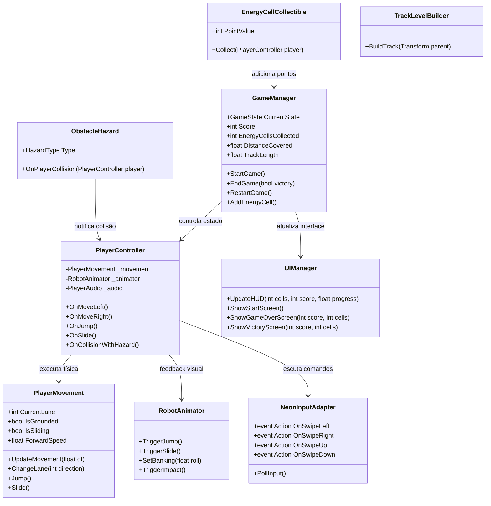

# Documento de Arquitetura Técnica — NEON RUSH

**Projeto:** NEON RUSH  
**Versão:** 1.0  
**Linguagem & Runtime:** C# 12 / .NET Standard 2.1 / Unity 6.3 LTS  
**Pipeline Gráfico:** Universal Render Pipeline (URP 17.3.0)  

---

## 1. Modularização por Assembly Definitions (asmdef)

Seguindo estritamente as normas de `docs/standards/architecture.md`, o código de Neon Rush é distribuído nos seguintes assemblies:

```
unity/Assets/Game/Scripts/
├── Foundation/             -> Studio.Foundation.asmdef (Eventos, Pooling, Constantes, Áudio Sintetizado)
├── Input/                  -> Studio.Input.asmdef (Adaptador Touch + Teclado unificado)
├── Camera/                 -> Studio.Camera.asmdef (Seguimento suave em 3ª pessoa)
├── Gameplay/               -> Studio.Gameplay.asmdef (Player, Obstáculos, Coleta, Pista, LevelBuilder)
├── UI/                     -> Studio.UI.asmdef (HUD, StartScreen, Victory/Defeat Screens)
└── Tests/
    ├── EditMode/           -> Studio.Tests.EditMode.asmdef (Lógica matemática, faixas, pontuação)
    └── PlayMode/           -> Studio.Tests.PlayMode.asmdef (Integração de movimento e colisões)
```

### Matriz de Dependências de Assemblies
- `Studio.Foundation`: Sem dependências.
- `Studio.Input`: Depende de `Studio.Foundation`, `Unity.InputSystem`.
- `Studio.Camera`: Depende de `Studio.Foundation`, `Unity.Cinemachine` (ou Cinemachine 3).
- `Studio.Gameplay`: Depende de `Studio.Foundation`, `Studio.Input`.
- `Studio.UI`: Depende de `Studio.Foundation`, `Studio.Gameplay`, `UnityEngine.UI`.
- `Studio.Editor`: Depende de `Studio.Gameplay`, `Studio.UI`, `UnityEditor`.

---

## 2. Diagrama de Classes e Componentes Principais



---

## 3. Gestão de Memória e Zero-GC Rules

Em conformidade com `docs/standards/unity.md`:
1. **Sem alocações em Update():**
   - Vetores `Vector3` calculados em campos de pilha locais.
   - Detecção de toques sem alocar listas de `Touch` ou `RaycastHit[]`.
   - Formatação numérica de HUD com caching de strings numéricas e `StringBuilder`.
2. **Consultas de Física:**
   - Colisões detectadas via `OnTriggerEnter` e `OnCollisionEnter` nativos do Unity PhysX.
   - Sem chamadas de `GameObject.Find` ou `GetComponent` em updates de frames; todas as dependências cacheadas no `Awake` ou injetadas.
3. **Áudio Sintetizado Procedural:**
   - Efeitos sonoros gerados uma única vez na inicialização via `AudioClip.Create` em `Studio.Foundation.ProceduralAudioService`, evitando carregar arquivos pesados ou alocações em tempo de execução.
