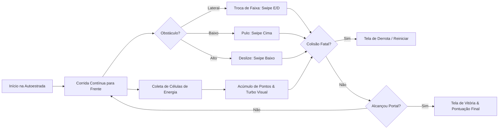

# Game Design Document (GDD) — NEON RUSH

**Projeto:** NEON RUSH — Vertical Slice 3D Mobile  
**Engine:** Unity 6.3 LTS (URP)  
**Público-Alvo:** Jogadores casuais/mid-core mobile (Android)  
**Versão:** 1.0  
**Data:** 15 de Outubro de 2026  
**Status:** Aprovado para Implementação  

---

## 1. Visão Geral e Premissa

### 1.1 Premissa Narrativa
No ano de 2089, o Setor 7 de Neo-Kyoto sofreu um blecaute quântico e começou a colapsar. Você controla **N3-0N** ("Neon"), um ágil droide de reconhecimento esférico-articulado. Equipado com propulsores de levitação e sensores cibernéticos, Neon precisa percorrer uma autoestrada de dados suspensa em alta velocidade, coletar **Células de Carga de Íons** e alcançar o **Portal de Extração Subquântico** antes do isolamento definitivo do setor.

### 1.2 Objetivo da Vertical Slice
Comprovar na prática a integridade de ponta a ponta do Game Studio:
- Jogabilidade fluida e responsiva com 60 FPS estáveis em dispositivos Android ARM64.
- Controles touch intuitivos (swipes) combinados com suporte completo a teclado no Editor.
- Direção de arte sci-fi estilizada e marcante (paleta ciano, violeta e magenta).
- Arquitetura limpa em C# 12, desacoplada via Assembly Definitions, com zero alocações na heap por frame.
- Pipeline de testes automatizados (UTF) e geração determinística de build Android (APK).

---

## 2. Mecânicas Centrais de Gameplay (Core Loop)

### 2.1 Movimento e Navegação
- **Velocidade Constante Progressiva:** O robô avança automaticamente pelo eixo Z a uma velocidade base de 12 m/s, acelerando sutilmente até 16 m/s próximo ao final do percurso.
- **Sistema de 3 Faixas (3-Lane System):**
  - Três pistas paralelas espaçadas em 2.2 metros (Esquerda: X = -2.2, Centro: X = 0, Direita: X = +2.2).
  - Transição lateral suave com interpolação quadrática rápida (duração ~0.15s), acompanhada de inclinação (*bank/roll*) visual da carcaça do robô.
- **Pulo (Jump):**
  - Altura máxima: 2.5 metros; duração do arco: 0.65s.
  - O robô ativa propulsores verticais, permitindo transpor barreiras elétricas térreas e alcançar células aéreas.
- **Deslize (Slide / Crouch):**
  - O robô compacta seu chassi e inclina seus propulsores para o plano horizontal por 0.6s, reduzindo seu colisor pela metade para passar sob vigas industriais e scanners holográficos.

### 2.2 Obstáculos
Cada obstáculo possui silhueta, cor e comportamento distintos:
1. **Barreira de Laser Baixa (Energy Hurdle):** Emite feixe pulsante de laser magenta a 0.5m do chão. Exige **Pulo**.
2. **Scanner Suspenso / Viga Alta (Overhead Conduit):** Viga cibernética suspensa a 1.6m com holograma de advertência. Exige **Deslize**.
3. **Monólito de Barricada (Lane Blocker):** Bloco poligonal monolítico de metal escuro com faixas amarelas e luz estroboscópica bloqueando uma faixa inteira. Exige **Desvio Lateral**.

### 2.3 Coletáveis e Pontuação
- **Células de Carga de Íons (Energy Cells):**
  - Octaedros cristalinos giratórios com núcleo ciano brilhante e emissão de partículas.
  - Distribuídos em sequências em linha reta nas faixas livres e flutuando sobre obstáculos para recompensar saltos precisos.
  - Valor: +100 pontos e +1 célula no inventário.
- **Multiplicador de Distância:** +10 pontos por metro percorrido.
- **Pontuação Final:** `(Metros Percorridos * 10) + (Células Coletadas * 100)`.

### 2.4 Condições de Término
- **Derrota:** Colisão frontal direta contra qualquer obstáculo sem a evasão correta. O robô emite faíscas cibernéticas, interrompe o avanço e exibe a tela de Game Over com botão instantâneo de Restart.
- **Vitória:** Atravessar a zona do Portal de Extração no final do percurso de 350 metros. O portal absorve o robô em um flash de luz ciano e abre a tela de Vitória com estatísticas detalhadas.

---

## 3. Controles e Mapeamento de Entrada

O jogo suporta simultaneamente **Touch Screen Nativo** e **Controles de Teclado no Editor/Desktop**:

| Ação | Controles Mobile (Touch) | Teclado (Editor / Standalone) |
|---|---|---|
| Mudar p/ Faixa Esquerda | Swipe para a Esquerda | Tecla `A` ou Seta para a Esquerda |
| Mudar p/ Faixa Direita | Swipe para a Direita | Tecla `D` ou Seta para a Direita |
| Pular | Swipe para Cima / Tap no terço superior | Tecla `W`, `Espaço` ou Seta para Cima |
| Deslizar | Swipe para Baixo / Tap no terço inferior | Tecla `S` ou Seta para Baixo |
| Reiniciar Partida | Botão na UI Touch | Tecla `R` ou Espaço |

---

## 4. Estrutura das Telas e Fluxo de Interface (UI)

1. **Tela de Título / Início (Start HUD):**
   - Logo estilizado "NEON RUSH" com brilho neon.
   - Instruções visuais rápidas (ícones animados de Swipe / Teclas).
   - Botão "INICIAR MISSÃO".
2. **HUD de Gameplay:**
   - Contador de Células de Energia (ícone de bateria neon ciano + texto legível).
   - Marcador de Pontuação em tempo real.
   - Barra de Progresso do Percurso (ícone do robô se deslocando até o Portal).
3. **Tela de Vitória (Extraction Complete):**
   - Mensagem: "EXTRAÇÃO CONCLUÍDA COM SUCESSO!"
   - Estatísticas: Células coletadas, pontuação total e tempo de percurso.
   - Botão "JOGAR NOVAMENTE".
4. **Tela de Derrota (System Overload):**
   - Mensagem: "AVARIA CRÍTICA NO DROIDE"
   - Estatísticas até o ponto de colisão.
   - Botão "TENTAR NOVAMENTE".
