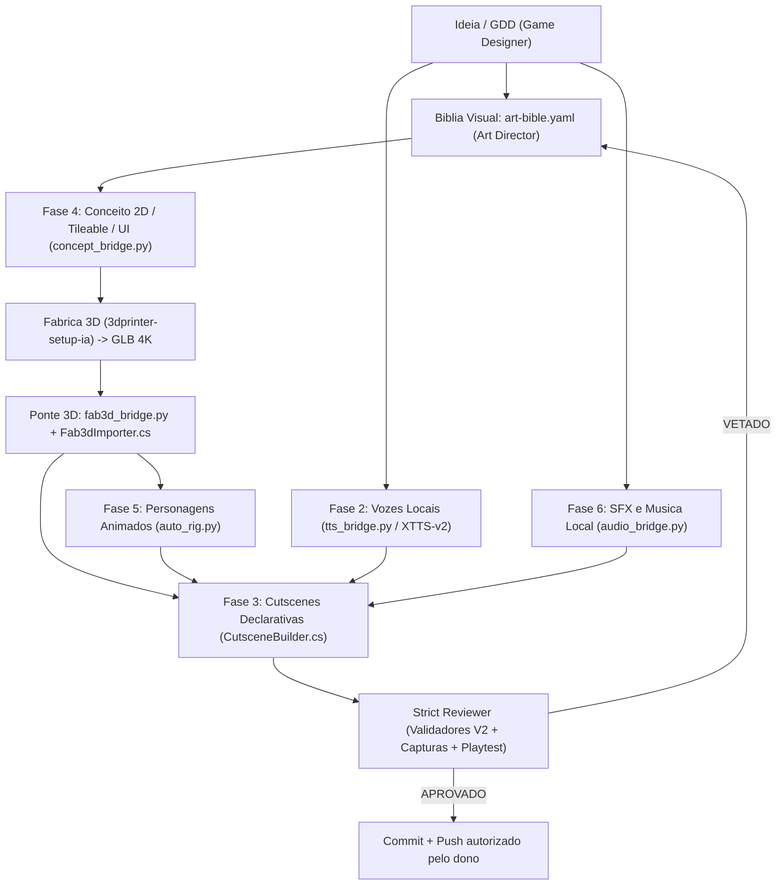

# Plano Mestre — Studio V2: Fábrica 100% Local de Criação de Games

> **Regra de ouro:** nada é baixado, gerado ou enviado (`git push`) sem aprovação prévia deste plano.
> Todo o pipeline roda **100% localmente** na RTX 3060 12 GB, **exclusivamente em `C:\`** (`D:\` defeituoso e proibido).

---

## 1. Arquitetura Global do Fluxo

---

## 2. Estado Atual (Já Implementado e Provado em Disco)

| Bloco | Commit em `gamedev-setup-ia` | Evidência / Status |
| --- | --- | --- |
| **Ponte 3D (ADR-005)** | `3c2b6ac8`, `1b0e722b`, `78c921f1` | Modo 1 provado (`prop_caixote__pbr_4k.glb`: 250k → 3k tris, URP Lit `_BaseMap` + `_MetallicGlossMap`, `validate_asset` exit 0, captura in-game). Arquivos de teste limpos de `unity/Assets/`. |
| **Fase 1 — Organização & Agentes** | `154d9272` | `studio-v2-local-pipeline.md`, `studio-git-workflow.md`, `art-bible.template.yaml`, skills `studio-art-director` e `studio-strict-reviewer`, `AGENTS.md` (Princípio 9). |
| **Fase 2 — TTS Local (XTTS-v2)** | `245ed4c6` | `tts_bridge.py` + `tts_xtts_worker.py` (reusa venv WSL + modelo já em cache, **0 MB download**). Smoke test PT-BR em CUDA aprovado (`7.138s`, `-1.0 dBFS`, `vo_manifest.json`). |
| **Fase 3 — Cutscene Builder** | `c488aa04` | `CutscenePlayer.cs` + `CutsceneBuilder.cs` + `build_cutscene.py` (JSON → Unity `TimelineAsset` + `AudioTrack` + Prefab + keyframes). Smoke test batchmode Unity 6.3 aprovado (`exit 0`, 2 keyframes). |
| **Fase 4 — Ponte 2D (Código)** | `3f27c206` | `concept_bridge.py` + `concept_diffusers_worker.py` (reusa `~/.venvs/hunyuan`, modos `concept`, `tileable` circular e `ui`). **Pendente:** aprovação do download do checkpoint (~6,5 GB) + smoke test. |

---

## 3. Plano Detalhado das Fases Restantes (Antes do Jogo Novo)

### Fase 4 — Fechamento da Ponte 2D Local (Conceito + Textura Tileável + UI)
- **Objetivo:** fechar o ciclo `texto → imagem 2D no estilo da Art Bible → Fábrica 3D → Unity`, além de gerar texturas tileáveis de chão/parede e ícones de UI.
- **Tecnologia:** `diffusers 0.33.1` + CUDA já instalados em `~/.venvs/hunyuan` + `stabilityai/sdxl-turbo` (fp16, 4 steps ≈ 1,5 s/imagem, sem token HF).
- **Custo em disco (`C:\`):** ~6,5 GB no cache HuggingFace (`~/.cache/huggingface/hub`).
- **Ações planejadas (somente após aprovação):**
  1. Rodar 1 smoke test `--mode concept` usando `art-bible.template.yaml`.
  2. Rodar 1 smoke test `--mode tileable` (validando `Conv2d` circular sem emenda).
  3. Inspecionar visualmente ambos os PNGs em `evidence/concepts/` e registrar evidências em `PROGRESS.md`.
- **Gate de conclusão:** exit 0 em `concept` e `tileable` + aprovação visual pelo dono.

---

### Fase 5 — Personagens Animados (`Fab3D → auto_rig.py → Unity`)
- **Objetivo:** permitir que personagens/criaturas gerados pela Fábrica 3D entrem no Unity já com esqueleto bípede, skinning limpo e animações base (`Idle`, `RunCycle`, `Jump`, `Slide`).
- **Tecnologia:** Blender 5.0.1 no WSL + `tools/art/auto_rig.py` (já existe no repo) integrado ao `fab3d_bridge.py` via flag `--auto-rig` (e atualização no `Fab3dImporter.cs` para configurar `ModelImporterAnimationType.Generic` / `Humanoid` e extrair clips).
- **Custo em disco (`C:\`):** **0 MB**.
- **Ações planejadas:**
  1. Integrar etapa opcional de `auto_rig.py` no fluxo `fab3d_bridge.py` para categorias `player_character` / `enemy_character`.
  2. Atualizar `Fab3dImporter.cs` para configurar `SkinnedMeshRenderer` + material URP Lit + animação no prefab.
  3. Rodar smoke test com `humanoide_dragonborn__pbr_4k.glb` (já existente em `3dprinter-setup-ia`), validar em `validate_asset.py` e capturar preview in-game.
  4. Documentar em `docs/operations/fab3d-character-rig-runbook.md` e limpar o asset de teste de `unity/Assets/` após evidência.
- **Gate de conclusão:** `fab3d_bridge.py --auto-rig` exit 0, prefab com `SkinnedMeshRenderer` + ≥1 `AnimationClip` importado, captura sem deformação quebrada.

---

### Fase 6 — SFX & Música Local (Áudio de Gameplay + Mixagem)
- **Objetivo:** padronizar efeitos sonoros (passos, impactos, botões, portas, combate) e trilhas de fundo 100% locais com volume normalizado (LUFS) e manifesto para o Unity.
- **Tecnologia:** auditar `tools/audio/download_sfx.py` + acervo local/CC0 já existente no `video-generate/music_library_builder` + criar `tools/audio/audio_bridge.py` (normalização LUFS/peak + conversão WAV/OGG + `audio_manifest.json` + import settings no Unity). Modelo gerativo local opcional (ex.: `Stable Audio Open Small` ~1,5 GB) só se você quiser síntese generativa além do acervo CC0.
- **Custo em disco (`C:\`):** **0 MB** (usando acervo local/CC0) ou **~1,5 GB** (se optar por modelo generativo).
- **Ações planejadas:**
  1. Inspecionar o que já existe em `tools/audio/` e `video-generate/music_library_builder`.
  2. Criar `tools/audio/audio_bridge.py` + `docs/operations/audio-sfx-runbook.md` + skill `.agents/skills/studio-audio-designer/SKILL.md`.
  3. Validar normalização e importação de 2 clipes de teste (1 SFX + 1 loop de música) com relatório em `evidence/audio/`.
- **Gate de conclusão:** áudio normalizado sem clipping, loop limpo, `audio_manifest.json` + evidência em `evidence/audio/`.

---

## 4. Plano de Nascimento do Primeiro Jogo Novo ("Fab3D-First")

Assim que o Studio Core fechar as Fases 4–6 (ou quando você decidir iniciar em paralelo):

1. **Repositório limpo (`game-<slug>`):** criado fora do NEON DISTRICT, herdando apenas o Studio Core (`tools/`, `.agents/skills/`, `AGENTS.md`, scripts base de `unity/Assets/Editor/` e `Scripts/`) + `.gitattributes` com **Git LFS** desde o commit 1.
2. **Alinhamento Criativo (1 sessão):**
   - GDD enxuto (`docs/gdd.md`): gênero aventura de escopo fechado (ex.: Ilha das Ruínas / Posto Alienígena / Dioramas).
   - Bíblia Visual (`docs/art/art-bible.yaml` via `studio-art-director`).
   - Elenco de Vozes (`docs/audio/voice-cast.json` com vozes gravadas por você ou amostras definidas).
3. **Vertical Slice (Fase 1 completa, ~15–20 assets 100% autorais):**
   - 1 protagonista animado (Fase 5) + 1–2 inimigos/guardiões;
   - 10–12 props/arquitetura pela Fábrica 3D + 2–3 texturas tileáveis de chão (Fase 4);
   - 1 cutscene de introdução dublada (Fases 2 + 3);
   - Revisão formal do `studio-strict-reviewer` antes de expandir para novas fases.

---

## 5. Resumo de Armazenamento em `C:\`

| Item | Espaço estimado | Status |
| --- | --- | --- |
| `C:\` livre hoje | **~119,7 GB** | Medido |
| Instaladores antigos no WSL (`cuda_12.8.0_linux.run` + `cuda_13.0.0_linux.run`) | **+9,7 GB recuperáveis** | Opcional (se você aprovar apagar) |
| Fase 4 (`stabilityai/sdxl-turbo`) | **−6,5 GB** | Aguarda aprovação |
| Fase 5 (Rigging / Animação) | **0 GB** | Reusa Blender 5.0.1 |
| Fase 6 (SFX / Música) | **0 GB** (CC0/local) ou **−1,5 GB** (gerativo) | Aguarda definição |

---

## 6. Decisões Aguardando Sua Aprovação

1. **Ordem de execução:** aprova executar **Fase 4 → Fase 5 → Fase 6** nessa ordem antes de criar o repo do Jogo Novo?
2. **Download Fase 4:** autoriza baixar `stabilityai/sdxl-turbo` (~6,5 GB em `C:\`) para validar a ponte 2D (`concept` + `tileable`)?
3. **Fase 6 (SFX/Música):** prefere começar **0 GB** (acervo local/CC0 + normalizador) ou já incluir modelo generativo local (~1,5 GB)?
4. **Limpeza opcional no WSL:** quer apagar os 2 instaladores antigos `cuda_*.run` (~9,7 GB) para liberar espaço no `C:\`?
5. **Git push:** quer autorizar `git push origin main` dos commits já concluídos no `gamedev-setup-ia`, ou prefere manter só local até terminar o Studio V2?
