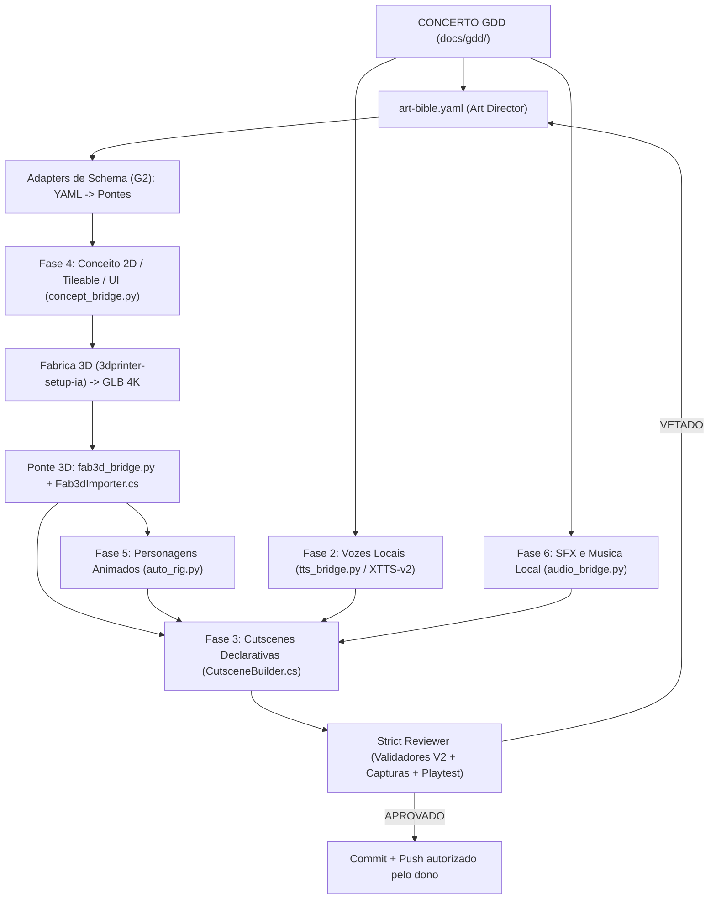

# Plano Mestre v2.0 — Studio V2: Fábrica 100% Local de Criação de Games → **CONCERTO**

> **Regra de ouro:** nenhum download de modelo, geração pesada ou alteração de código/binário
> é executado sem aprovação prévia deste plano. *(Exceção explícita: commits/pushes de
> documentação de planejamento podem ser sincronizados quando autorizados pelo dono.)*
>
> Todo o pipeline roda **100% localmente** na RTX 3060 12 GB, **exclusivamente em `C:\`**
> (`D:\` defeituoso e proibido). Modelos pesados de GPU (XTTS-v2, SDXL-Turbo, TRELLIS.2,
> Hunyuan3D) rodam **sempre de forma sequencial**, nunca simultâneos na VRAM de 12 GB.

---

## 1. Arquitetura Global do Fluxo

---

## 2. Estado Real Verificado (Espelho Exato do `PROGRESS.md`)

| Bloco | Commit em `main` | Status Real | Evidência em Disco / Observações Honestas |
| --- | --- | --- | --- |
| **Ponte 3D (ADR-005)** | `3c2b6ac8`, `1b0e722b`, `78c921f1` | ✅ **Concluído (Modo 1)** | `evidence/art/fab3d_bridge_prop_caixote.json` (250k → 3k tris), `fab3d-import-report.json`, `fab3d_prop_caixote.png`. `unity/Assets/` limpo. |
| **Fase 1 — Organização & Agentes** | `154d9272`, `72f85534` | ✅ **Concluído** | Roadmap, padrão Git, `art-bible.template.yaml`, skills `studio-art-director` e `studio-strict-reviewer`, `AGENTS.md` (incl. Regra Anti-Overclaim), `.gitattributes` (LFS ativo). |
| **Fase 2 — TTS Local (XTTS-v2)** | `245ed4c6` | ✅ **Concluído** | `evidence/audio/tts_bridge_smoke_test.json` (2 falas PT-BR, 7.138s, 24 kHz, `-1.0 dBFS`, `cuda`, `errors: []`). **0 MB download.** |
| **Fase 3 + 3b — Cutscene Builder + VO** | `c488aa04`, `5e97612d` | ✅ **Concluído (Tier 1)** | `evidence/cutscenes/cutscene_integration_vo.json` (`audio_clips_bound: 2`, `9.277s`, `TimelineAsset` + Prefab + 2 keyframes, `errors: []`). |
| **Adapters de Schema (G2) + Env Vars** | `5e97612d` | ✅ **Concluído (Adapter)** | `evidence/studio/g2_adapters_validation.json` (PASS nos 3 YAMLs reais do CONCERTO via `PyYAML` no WSL em `yaml_loader.py`). *Pendente no worker (`tts_xtts_worker.py`):* aplicar `retry` de `max_duration_ms`, `speed` e `fx` (hoje preservados como metadados). |
| **Fase 4 — Ponte 2D Local (`sdxl-turbo`)** | `3f27c206`, `b022c8c3` | ✅ **Concluído (Gate técnico)** | Download (~6,5 GB em `C:\`) autorizado pelo dono em 21/11 após limpeza de `+51,94 GB` (Crash CTR) + `+9 GB` WSL (`cuda_*.run`) → `171,46 GB` livres em `C:\`. `evidence/art/concept_smoke_*.json` + `evidence/concepts/smoke_*.png` (LFS). *Inspeção visual feita pela IA; aprovação estética final pelo dono disponível a qualquer momento.* |
| **Fase 5 — Personagens Animados (Base)** | `b022c8c3` | ✅ **Concluído (Base)** | `fab3d_bridge.py --auto-rig` + `Fab3dImporter.cs`: `smoke_dragonborn` (4.500 tris, 18 ossos, 4 clips, `validate_asset` exit 0, `fab3d_smoke_dragonborn.png`). *Upgrade profissional planejado na Fase 5.1 abaixo.* |
| **Fase 6 — SFX & Música Local (CC0/EBU R128)** | `629d92f2` | ✅ **Concluído** | `audio_bridge.py` (`ffmpeg` nativo, 0 MB) + `evidence/audio/audio_bridge_smoke_{sfx,music}.json` (`-16/-18 LUFS`, `errors: []`). |

---

## 3. Plano Detalhado das Fases Restantes (Studio Core)

### 3.0 Teste de Integração TTS → Cutscene (Fecha a lacuna da Fase 3)
- **Objetivo:** provar o fluxo real `tts_bridge.py → vo_manifest.json → CutsceneBuilder.cs` com áudio ligado no `TimelineAsset`.
- **Custo em disco:** **0 MB**.
- **Gate:** `evidence/cutscenes/cutscene_integration_vo.json` com `audio_clips_bound >= 2`, `timeline_asset != ""`, `prefab_asset != ""`, `errors: []` + keyframes capturados (e limpeza dos arquivos de teste em `unity/Assets/` após evidência).

### 3.1 Estória G2 — Adapters de Schema (`CONCERTO YAML` → Pontes do Estúdio)
Os contratos YAML do pacote **CONCERTO** são a **fonte da verdade**; os JSONs consumidos pelas pontes passam a ser artefatos derivados (ou lidos diretamente) sem perda silenciosa:

| Contrato CONCERTO | Lacuna identificada (Review `dd3cd64`) | Adaptação planejada |
| --- | --- | --- |
| `art-bible.yaml` | Usa `prompt_base.{text, negative}` + `characters.<id>.prompt_mod` + `palettes.<fuso>`, enquanto `concept_bridge.py` só lia `local_generation_prompts.*` | Estender `concept_bridge.py` para suportar `prompt_base.{text, negative}` + flags `--character <id>` e `--fuso <id>` (falhando com erro explícito se o prompt resultar vazio — nunca silêncio). |
| `dialogues.yaml` | 7 vozes com `xtts-v2`/`kokoro-82m`/`f5-tts`, idioma `"pt-BR"`, `speed`, `max_duration_ms` e `subtitles.{pt-BR,en}` | `tools/audio/dialogue_adapter.py` implementado: converte `"pt-BR" → "pt"`, roteia engines não-XTTS com warnings explícitos e preserva `max_duration_ms`, `speed`, `fx` e `subtitles.{pt-BR,en}` nos JSONs derivados. *(Pendente no `tts_xtts_worker.py`: implementar execução real de `retry` de `max_duration_ms`, `speed` e `fx` antes da produção final de VO do CONCERTO.)* |
| `cutscene_01_abertura.yaml` | 165 s, múltiplos `sets`, `actors` com poses, `camera.{type, lens_mm, dof}`, `music.fades` | **Tier 1 (Vertical Slice):** `tools/studio/cutscene_adapter.py` converte o YAML rico para o JSON do `CutsceneBuilder.cs` (`lens_mm → fov`, `dolly`/`orbit`/`static` → camera rails, `vo` → `vo_line_id`, legendas bilíngues). **Tier 2 (Produção CONCERTO):** evoluir `CutsceneBuilder.cs` para `actors`/poses, `music.fades` (ducking) e troca de `sets`. |

> **Higiene técnica (G5):** externalizar caminhos padrão de máquina via variáveis de ambiente (`STUDIO_UNITY_EXE`, `STUDIO_WSL_TTS_PYTHON`, `STUDIO_WSL_2D_PYTHON`) mantendo os caminhos atuais do Bruno como fallback.

### 3.2 Fase 4 — Fechamento da Ponte 2D Local (`concept` + `tileable` + `ui`)
- **Tecnologia:** `diffusers 0.33.1` + CUDA já instalados em `~/.venvs/hunyuan` + `stabilityai/sdxl-turbo` (fp16, 4 steps ≈ 1,5 s/imagem).
- **Custo em disco (`C:\`):** ~6,5 GB (após limpeza recomendada dos `cuda_*.run` de ~9,7 GB).
- **Gate:** exit 0 em `--mode concept` (usando `art-bible.yaml` real do CONCERTO, ex.: `porca` ou prop do Caldeiral) + `--mode tileable` (piso metálico/oficina sem emenda) + 2 PNGs inspecionados visualmente + `PROGRESS.md` marcado `[x]`.

### 3.3 Fase 5 — Personagens Animados (`Fab3D → auto_rig.py → Unity`)
- **Objetivo:** integrar `tools/art/auto_rig.py` (já existente) no `fab3d_bridge.py` (`--auto-rig`) + `Fab3dImporter.cs` (`SkinnedMeshRenderer` + `AnimationClip`).
- **Custo em disco (`C:\`):** **0 MB**.
- **Gate:** smoke test com `humanoide_dragonborn__pbr_4k.glb` (já na Fábrica), exit 0, `SkinnedMeshRenderer` + ≥1 clip (`Idle`/`RunCycle`) + captura sem deformação quebrada.

### 3.4 Fase 6 — SFX & Música Local (CC0/Local primeiro)
- **Objetivo:** criar `tools/audio/audio_bridge.py` (normalização `-16 LUFS` / `-1 dBTP`, conversão `.ogg`/`.wav`, `audio_manifest.json`) aproveitando `tools/audio/download_sfx.py` e o acervo local/CC0 existente.
- **Custo em disco (`C:\`):** **0 MB** no modo CC0/local (modelo generativo ~1,5 GB só se o CC0 não cobrir o estilo *clockwork-whimsy* do CONCERTO).
- **Gate:** 1 SFX + 1 loop de música normalizados, sem clipping, com relatório em `evidence/audio/`.

---

## 4. Primeiro Jogo Novo ("Fab3D-First"): **CONCERTO** (Série ORA)

O primeiro jogo oficial construído sobre o Studio V2 é **CONCERTO** (pacote `concerto-gdd.zip`, v0.3):
- **Protagonista:** Desiderio (**"Dez"**) — mecânico alienígena de 4 braços com dispositivo **Bis**; companheira drone **Porca**; antagonista **Iria** (Sincronato); irmã perdida **Juno**; 6 **Fusos** (começando pelo **Caldeiral**).
- **Repositório dedicado (`game-concerto`):** nasce limpo fora do NEON DISTRICT, herdando apenas o Studio Core (`tools/`, `.agents/skills/`, `AGENTS.md`, importers/builders Unity) e configurando **Git LFS** desde o commit 1 (`*.fbx`, `*.glb`, `*.png`, `*.wav`, `*.ogg`, `*.pdf`, `evidence/**/*.png`).
- **Estrutura de entrada do pacote `concerto-gdd.zip` em `game-concerto`:**
  - `docs/gdd/` ← `00-visao-geral.md` até `11-roadmap.md` + `README.md` + `CONCERTO-GDD.pdf` (LFS)
  - `docs/art/art-bible.yaml` ← `art-bible.yaml` do pacote (fonte da verdade)
  - `docs/narrative/dialogues.yaml` ← `dialogues.yaml` do pacote (fonte da verdade)
  - `docs/narrative/cutscenes/cutscene_01_abertura.yaml` ← `cutscene_01_abertura.yaml` do pacote
  - `voices/<personagem>/*.wav` ← 7 amostras de voz (6–15 s cada: `dez`, `iria`, `porca`, `vo_segunda`, `tio_horario`, `juno`, `narrador`) gravadas/definidas pelo dono.
- **Vertical Slice alvo (Marco M1–M2 do CONCERTO):**
  - Cutscene `cs01_abertura` dublada (6 falas reais do `dialogues.yaml`) + 1º Fuso jogável (**Caldeiral** compacto com Dez, Porca, 1 inimigo Ferrugem Temporal, 8–10 props clockwork da Fábrica 3D e 2 texturas tileáveis).

---

## 5. Higiene Git LFS & Manutenção do Studio Core (G3 + G5)

- **`.gitattributes` ampliado (forward-only):** incluir `evidence/**/*.png`, `evidence/**/*.jpg` e `*.pdf` no LFS para impedir crescimento de blobs novos (migração retroativa do histórico de 142 MB em `gamedev-setup-ia` fica como decisão separada — não reescrevemos histórico sem pedido explícito).
- **`PROGRESS.md`:** arquivar o histórico antigo v3.x do NEON DISTRICT em `docs/operations/log-v3.x.md` quando conveniente para manter `PROGRESS.md` enxuto.

---

## 6. Definition of Done Macro do Studio V2 (Critério para Liberar `game-concerto`)

O Studio V2 é declarado **PRONTO** quando todos os 6 gates abaixo estiverem `[x]` no `PROGRESS.md` com evidência em disco:
1. [x] Teste de integração **TTS → Cutscene** com `audio_clips_bound >= 2` e `errors: []` (`evidence/cutscenes/cutscene_integration_vo.json`).
2. [x] **Adapters G2** (`art-bible.yaml`, `dialogues.yaml`, `cutscene_01_abertura.yaml` do CONCERTO) testados sem perda silenciosa (`evidence/studio/g2_adapters_validation.json`).
3. [x] **Fase 4 (2D local):** `concept` + `tileable` aprovados visualmente (`evidence/concepts/smoke_*.png` + `evidence/art/concept_smoke_*.json`).
4. [x] **Fase 5 (Rigging):** 1 personagem humanoide da Fábrica rigado e importado no Unity (`SkinnedMeshRenderer` + 4 animações, `evidence/captures/fab3d_smoke_dragonborn.png`).
5. [x] **Fase 6 (SFX/Música):** `audio_bridge.py` validado em modo CC0/local com normalização LUFS (`evidence/audio/audio_bridge_smoke_*.json`).
6. [x] **Higiene:** zero arquivos temporários em `unity/Assets/`, `.gitattributes` com LFS ativo, `AGENTS.md` com regra anti-overclaim.

---

## 7. Fase 5.1 — Upgrade Profissional de Animação (Opcional, Pós-Vertical Slice)

> **Critério definido pelo dono:** foco na melhor qualidade técnica 100% local (sem filtro de licença; verificação técnica sempre na fonte oficial). O `auto_rig.py` atual fecha o vertical slice; a Fase 5.1 eleva rigging e animação para nível de produção:

| Estágio | Stack (100% local, `C:\`) | Escopo e Gate |
| --- | --- | --- |
| **5.1-A (0 MB)** | **Quaternius UAL** (já existe em `QuaterniusPedPipeline.cs` + `import_quaternius_pack.py`) + `Fab3dImporter` → `ModelImporterAnimationType.Human` + Animation Rigging IK | Reutilizar UAL como biblioteca oficial + avatar config no 1º personagem do CONCERTO |
| **5.1-B (~2–4 GB seletivo)** | **UniRig** (WSL headless, baixar **somente** checkpoints `skeleton/` + `skin/`, jamais `data/`) + **MoMask** (texto → BVH, roda até em CPU) + **Estória 5.1-B2** (normalizador de ossos Mecanim/`keemap` + retarget automatizado em `bpy`) | Gate: 1 criatura/personagem rigado com UniRig + 3 clips UAL retargetados sem retoque manual + 1 gesto MoMask → BVH → captura |
| **5.1-C (Opcional)** | **GVHMR** (vídeo → SMPL → conversor SMPL→BVH, medir VRAM real no 1º run) | Cenas expressivas gravadas em vídeo curto para cutscenes |

---

## 8. Registro de Aprovações & Próxima Decisão

- **Aprovações já concedidas pelo dono (21/11):** limpeza dos instaladores `cuda_*.run` (+9 GB WSL) e sobras do Crash CTR (+51,94 GB em `C:\` → `171,46 GB` livres medidos); execução de Fase 3b + G2 + download `sdxl-turbo` (~6,5 GB) + Fases 4/5/6; pushes até `b022c8c3`.
- **Próxima decisão em aberto:**
  1. Abrir agora o repositório limpo **`game-concerto`** (com o pacote `concerto-gdd.zip` + Git LFS + vertical slice usando a base atual do Studio V2) **ou** executar o **Estágio 5.1-A (Quaternius UAL + Humanoid)** antes?
  2. (Opcional) Implementar `retry` de `max_duration_ms` + `speed` no `tts_xtts_worker.py` antes da gravação das vozes do CONCERTO.
