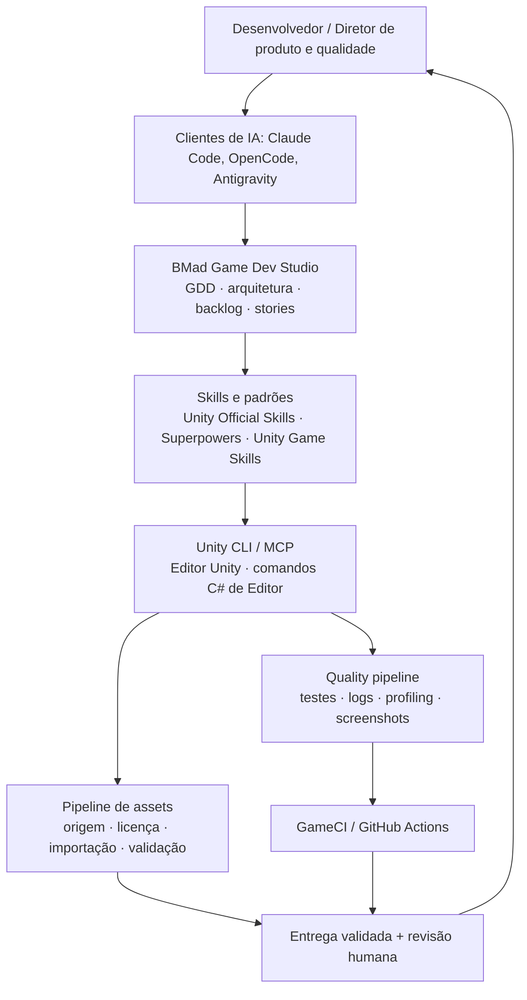
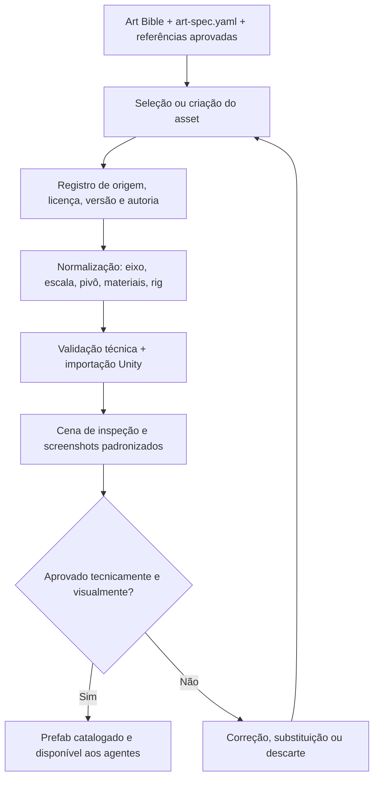

# Plano de Arquitetura — Game Studio com Agentes de IA

**Documento de referência para construção de uma plataforma reutilizável de desenvolvimento de jogos 3D mobile com IA**  
**Versão:** 1.0  
**Data:** 15 de outubro de 2026  
**Plataformas iniciais:** Android; iOS em uma segunda etapa  
**Perfil de execução:** desenvolvedor experiente em software e orquestração de agentes, iniciando em game development

> **Tese central:** não construir um jogo por meio de um prompt genérico. Construir uma infraestrutura de engenharia, produção e qualidade que permita a agentes de IA desenvolver jogos repetidamente, sob especificações, testes, padrões artísticos e critérios de aceitação verificáveis.

---

## 1. Visão e princípios de projeto

A meta é criar um **Game Development Platform / Game Studio Starter**, inicialmente um repositório-template, que dê origem a jogos independentes e, após validação, a bibliotecas reutilizáveis.

Princípios arquiteturais:

1. **Agnóstico ao agente:** Claude Code, OpenCode e Antigravity devem acessar a mesma fonte de verdade. O agente é um cliente intercambiável, não o proprietário do processo.
2. **Documentação antes da implementação:** decisões de arquitetura, GDD, direção artística, critérios de aceitação e contratos técnicos devem ser persistidos e versionados.
3. **Automação verificável:** código compilando não basta; toda entrega exige evidências técnicas, funcionais e, quando pertinente, visuais e de performance.
4. **Qualidade artística e game feel como disciplinas independentes:** esses aspectos não podem ser tratados como consequências automáticas da geração de código.
5. **Reutilização demonstrada, não presumida:** sistemas compartilhados só viram pacotes depois de testados em um projeto real.
6. **Poucas fontes de autoridade:** evitar a instalação indiscriminada de frameworks que competem pelo controle do mesmo workflow.
7. **Escopo progressivo:** primeiro comprovar a automação do editor; depois pipelines de qualidade; somente então criar uma vertical slice.

### O que o projeto não pretende fazer na primeira versão

- Criar uma interface web própria para administrar agentes.
- Desenvolver um novo orquestrador multiagente.
- Substituir completamente artistas, animadores e game designers.
- Gerar todos os modelos 3D com scripts Python ou serviços generativos.
- Iniciar pelo multiplayer, por mundo aberto ou por monetização complexa.
- Montar um monorepo com vários jogos antes de existir uma base estável.

---

## 2. Stack e repositórios recomendados

A estratégia é combinar peças com **responsabilidades distintas**. A recomendação é de arquitetura; não significa que todas as integrações já estejam homologadas em conjunto.

| Camada | Solução | Decisão | Responsabilidade |
|---|---|---|---|
| Processo de produção | [BMad Game Dev Studio](https://github.com/bmad-code-org/bmad-module-game-dev-studio) | **Adotar** | GDD, arquitetura, planejamento, stories, agentes e workflows de produção |
| Conhecimento de Unity | [Unity Official Skills](https://github.com/Unity-Technologies/skills) | **Adotar** | Conhecimento e procedimentos específicos da engine |
| Execução do editor | **Unity CLI + MCP oficial** | **Adotar com validação** | Comunicação com o Unity Editor, automação e execução de operações |
| Disciplina de engenharia | [Superpowers](https://github.com/obra/superpowers) | **Importar seletivamente** | TDD, debugging sistemático, code review e verificação antes de concluir |
| Arte e produção visual | [Unity Game Skills](https://github.com/tea-x-random/unity-game-skills) | **Importar seletivamente** | Direção artística, pipeline de assets, composição e QA visual |
| CI e builds | [GameCI](https://github.com/game-ci) | **Adotar após testes locais** | Testes e builds automatizados no GitHub Actions |
| MCP comunitário alternativo | [CoplayDev Unity MCP](https://github.com/CoplayDev/unity-mcp) | **Plano B** | Cobrir possíveis lacunas do MCP/CLI oficial |
| Outro MCP comunitário | [IvanMurzak Unity MCP](https://github.com/IvanMurzak/Unity-MCP) | **Comparar se necessário** | Alternativa para agentes e automação do Unity |
| Workflow Unity alternativo | [unity-ai-workflow](https://github.com/devdavv/unity-ai-workflow) | **Consultar, sem instalação integral** | Aproveitar conceitos e documentos relevantes |
| Especificação por mudança | [OpenSpec](https://github.com/Fission-AI/OpenSpec) | **Opcional** | Útil se a gestão de mudanças do BMad se mostrar insuficiente |

### Por que não instalar tudo?

BMad, Superpowers, OpenSpec e outros frameworks podem exigir fluxos diferentes de planejamento, execução e aprovação. Misturá-los indiscriminadamente cria regras concorrentes e documentação duplicada.

**Regra:** o **BMad** coordena o *processo de produção*. As **skills oficiais da Unity** fornecem conhecimento técnico; skills selecionadas do **Superpowers** melhoram disciplina; skills selecionadas do **Unity Game Skills** apoiam arte e gameplay. A **Unity CLI/MCP** executa operações. Os **validadores e o CI** decidem tecnicamente se uma entrega passou.

### Stack técnica inicial

| Área | Tecnologia |
|---|---|
| Engine | **Unity 6.3 LTS** como baseline inicial, sujeita à verificação da versão disponível e da compatibilidade dos pacotes |
| Linguagem | C# |
| Renderização | Universal Render Pipeline (URP) |
| Plataforma de referência | Android |
| Entrada | Unity Input System |
| Câmeras | Cinemachine |
| Animações | Animator; rigs humanoides quando fizer sentido |
| Testes | Unity Test Framework; Performance Testing API |
| Automação | Unity CLI, MCP e ferramentas de Editor em C# |
| Versionamento | Git + Git LFS |
| 3D e processamento de assets | Blender, ferramentas de conversão e assets aprovados |
| CI | GitHub Actions + GameCI |

**Nota de compatibilidade:** o estado e a interface da Unity CLI podem evoluir; tratá-la como dependência experimental e fixar versões. Antes de institucionalizar comandos, confirmar a documentação oficial instalada e provar cada operação em um projeto descartável.

---

## 3. Arquitetura lógica



### Contratos entre camadas

- **Planejamento:** produz documentos e stories, com critérios de aceitação claros.
- **Skills:** definem procedimentos, convenções, referências e limites de operação.
- **Ferramentas:** expõem ações reais e reproduzíveis, preferencialmente com saída estruturada.
- **Validadores:** geram evidências e falham explicitamente quando um critério obrigatório não é atendido.
- **Revisão humana:** aprova direção artística, ritmo, jogabilidade e sensação dos controles.

O MCP é um **mecanismo de conexão**, não uma arquitetura de qualidade. A capacidade de chamar o editor não substitui especificação, testes e curadoria.

---

## 4. Repositórios e estratégia de evolução

### 4.1 Repositório inicial: `game-studio-starter`

Criar um **template Git** em vez de um monorepo de vários jogos. Cada novo jogo será instanciado a partir desse template e terá histórico, dependências e GDD próprios.

Estrutura **proposta** (diretórios de agentes e BMad devem ser gerados/adaptados por seus instaladores; nomes e convenções variam entre clientes):

```text
game-studio-starter/
├── AGENTS.md                         # Contrato central dos agentes
├── CLAUDE.md                         # Adaptador curto para Claude Code
├── .agents/
│   └── skills/
│       └── studio-custom/            # Skills próprias, quando necessárias
├── .claude/                           # Configuração gerada para Claude
├── .agent/                            # Configuração, quando aplicável
├── .opencode/                         # Configuração para OpenCode
├── _bmad/                             # Framework BMad instalado
├── _bmad-output/                      # Produção documental gerada pelo BMad
├── docs/
│   ├── standards/
│   │   ├── unity.md
│   │   ├── architecture.md
│   │   ├── testing.md
│   │   ├── mobile-performance.md
│   │   └── asset-quality.md
│   ├── art/
│   │   ├── art-bible.md
│   │   ├── art-spec.yaml
│   │   └── references/
│   ├── decisions/
│   │   └── ADR-001.md
│   └── operations/
│       ├── onboarding.md
│       ├── troubleshooting.md
│       └── release-checklist.md
├── tools/
│   ├── setup/
│   ├── validation/
│   ├── asset-pipeline/
│   ├── capture/
│   └── android/
├── unity/
│   ├── Assets/
│   │   ├── Game/
│   │   ├── Editor/
│   │   └── Tests/
│   ├── Packages/
│   └── ProjectSettings/
├── .github/
│   └── workflows/
├── .gitattributes
└── .gitignore
```

Regras de organização:

- `AGENTS.md` deve ser **curto**, com ponteiros para documentos canônicos, comandos aceitos, restrições e Definition of Done.
- Não duplicar GDD e arquitetura entre `docs/` e `_bmad-output/`. Definir explicitamente qual arquivo é a fonte de verdade para cada assunto.
- Manter skills canônicas versionadas; adaptar descoberta e instalação para cada cliente, evitando três cópias divergentes.
- Fixar versões de Unity, pacotes, frameworks de agentes e ferramentas. Registrar upgrades via ADR.
- Excluir diretórios gerados e temporários do Unity do Git; versionar arquivos de projeto e `.meta` necessários. Usar Git LFS onde justificável para binários grandes.

### 4.2 Repositório futuro: `unity-studio-packages`

Somente após uma vertical slice aprovada e a identificação de componentes realmente reutilizáveis:

```text
unity-studio-packages/
├── com.studio.foundation/
├── com.studio.input/
├── com.studio.camera/
├── com.studio.gameplay/
├── com.studio.mobile/
├── com.studio.qa/
└── com.studio.asset-tools/
```

Distribuir como **Unity Package Manager (UPM)**, com versões, testes e changelog. Não extrair abstrações prematuramente.

---

## 5. Camada de agentes e conhecimento

### 5.1 BMad como autoridade de planejamento

Usar o **BMad Game Dev Studio** para organizar:

- Visão e público-alvo do jogo.
- Pesquisa, escopo e objetivos do MVP/vertical slice.
- GDD e documentos de experiência.
- Arquitetura técnica e decisões documentadas.
- Épicos, stories, dependências, critérios de aceitação e progresso.

Se o BMad propuser algo que diverge dos padrões técnicos do repositório, registrar uma decisão explícita: não deixar os agentes resolverem contradições implicitamente.

### 5.2 Unity Official Skills como fonte técnica

Utilizar as [skills oficiais da Unity](https://github.com/Unity-Technologies/skills) como referência para tarefas de engine, práticas e integrações. Fixar um commit/tag e testar atualizações antes de disponibilizá-las a todos os agentes.

### 5.3 Superpowers — importar apenas o que agrega valor

Priorizar as skills relacionadas a:

- `test-driven-development`;
- `systematic-debugging`;
- `verification-before-completion`;
- `requesting-code-review`;
- `writing-skills`.

Não habilitar dois orquestradores completos concorrendo pela mesma tarefa. Verificar dependências internas e compatibilidade antes de copiar/habilitar skills individuais.

### 5.4 Unity Game Skills — módulos artísticos selecionados

Analisar e adaptar principalmente:

- `unity-art-direction`;
- `unity-asset-pipeline`;
- `unity-scene-composition`;
- `unity-animation`;
- `unity-graphics`;
- `unity-gameplay-systems`.

O agente ou skill denominado `unity-game-director` não será o gerente de processo principal: essa responsabilidade já pertence ao BMad. Também não adotar automaticamente integrações que exigem APIs de geração de mídia sem antes justificar custos e qualidade.

### 5.5 Clientes de IA: implantação progressiva

| Cliente | Papel inicial proposto | Observação |
|---|---|---|
| **Claude Code** | Primeiro cliente para integrar e homologar o fluxo Unity | Boa documentação nas ferramentas selecionadas |
| **OpenCode** | Ferramentas, scripts, validação, implementação alternativa | Compartilha os contratos e testes |
| **Antigravity** | Segunda implementação, inspeção e revisões | Testar integração e capacidade visual reais |
| **Devin** | Tarefas isoladas em repositório, CI, refatorações | Instância na nuvem não acessa automaticamente o Unity Editor local |

Trabalhar com **uma única instância responsável por modificar uma cena/prefab** em cada momento. Para paralelismo, preferir branches/worktrees e projetos Unity isolados. Evitar edições simultâneas na mesma cena aberta por diferentes agentes.

---

## 6. Camada de execução: Unity CLI, MCP e ferramentas de Editor

### Caminho preferido

1. Instalar Unity Hub, a versão Unity escolhida e o suporte à plataforma Android.
2. Criar projeto URP mínimo e versioná-lo.
3. Instalar/configurar a Unity CLI/Pipeline seguindo a documentação da versão utilizada.
4. Conectar **um** agente via MCP e confirmar que ele identifica corretamente o projeto/editor.
5. Executar operações pequenas: inspecionar projeto, criar cena temporária, adicionar objeto/componente, salvar e verificar resultado.
6. Executar testes e gerar uma build Android simples por comandos reproduzíveis.

**Não pressupor que o MCP oficial cobre todas as operações.** Quando faltar funcionalidade, primeiro criar um comando de Editor em C# e expô-lo por uma interface executável. Avaliar [CoplayDev Unity MCP](https://github.com/CoplayDev/unity-mcp) ou [IvanMurzak Unity MCP](https://github.com/IvanMurzak/Unity-MCP) apenas se houver lacuna relevante documentada.

### Comandos de configuração (referências, não script de instalação universal)

```bash
# Preparação do repositório
git lfs install

# Instalador interativo do BMad: selecionar Game Dev Studio
npx bmad-method install

# Instalar/adaptar skills oficiais conforme o cliente
npx skills add Unity-Technologies/skills
```

Com Unity CLI devidamente instalada e compatível, investigar os comandos da versão em uso, por exemplo:

```bash
unity --help
unity status
unity pipeline --help
unity mcp --help
```

**Importante:** verificar nomenclatura, autenticação, pré-requisitos e sintaxe no release fixado. Não criar uma automação de produção copiando comandos sem testá-los no ambiente real.

### Padrão para ferramentas próprias

Criar ferramentas pequenas, determinísticas e preferencialmente com resultado JSON/JUnit:

| Ferramenta | Responsabilidade |
|---|---|
| `ValidateScene` | Referências, scripts ausentes, componentes inválidos, configurações proibidas |
| `ValidateAsset` | Escala, orientação, malha, materiais, texturas, rig, importação e metadados |
| `CaptureScene` | Capturas reproduzíveis de cenas em ângulos e dispositivos/perfis definidos |
| `ValidateMobileBudget` | Comparar medidas de performance com os limites do aparelho-alvo |
| `GenerateQAReport` | Consolidar evidências e falhas por feature/build |

A regra é que o **resultado do validador determine a aprovação automática**; o agente apenas interpreta o erro e tenta corrigi-lo.

---

## 7. Pipeline artístico: principal proteção contra jogos genéricos

**Decisão central:** Blender com Python não será considerado a solução universal para criar arte 3D profissional. Ele é muito útil para operações programáticas, mas criar geometria funcional é diferente de produzir modelos com qualidade artística, topologia e identidade visual.

### Fontes de assets, por prioridade pragmática

1. **Assets profissionais prontos**, compatíveis com a direção artística e a licença do projeto.
2. **Modelos e animações feitos por artistas**, especialmente para personagens/elementos que definem a identidade do jogo.
3. **Ferramentas especializadas de IA 3D**, somente quando os resultados passarem por testes de qualidade e o custo for justificável.
4. **Blender procedural**, para cenários modulares simples, protótipos, variações controladas, transformação, LOD e preparação de modelos.

Bibliotecas para avaliação: [Unity Asset Store](https://assetstore.unity.com/), [Kenney](https://kenney.nl/assets) e [Poly Haven](https://polyhaven.com/). Verificar a licença **do asset específico**; nunca presumir que todos têm a mesma licença.

### Pipeline proposto



### Contrato por asset

Cada asset importante deve conter um manifesto com pelo menos:

- Identificador e versão;
- origem, autor, licença e direitos de uso comercial;
- categoria, dimensões, escala e orientação;
- orçamento de geometria e materiais aplicável ao perfil do projeto;
- textura(s), resoluções e compressão;
- rig, animações e compatibilidades, quando aplicável;
- dependências;
- estado: `prototype`, `pending_review`, `approved`, `rejected`;
- referências visuais e evidências de validação.

**Política:** agentes de produção usam somente assets `approved`; protótipos podem usar exceções explicitamente marcadas.

### Art Bible e cena de referência

Antes do primeiro jogo completo, criar uma **cena de calibração visual** com assets aprovados e iluminação, URP, pós-processamento, câmera e animação já ajustados. Ela se torna o *benchmark* visual. Uma nova cena não precisa recriar a identidade visual desde o zero.

Itens mínimos de um `art-bible.md`:

- Direção estética e referências positivas/negativas;
- paleta de cores, materiais e tratamentos de iluminação;
- linguagem de formas, proporções e silhuetas;
- regras de composição e densidade visual;
- escala de personagens e cenários;
- linguagem de efeitos, UI e feedback de impacto;
- limites técnicos de arte para aparelhos-alvo.

---

## 8. Engenharia, testes e quality gates

A plataforma precisa diferenciar **testar software** de **aprovar um jogo**.

### Quatro níveis de validação

| Nível | Momento | Verificações | Resultado esperado |
|---|---|---|---|
| **1. Alteração** | A cada tarefa/commit relevante | Compilação, EditMode, referências, formato/configurações | Feedback técnico rápido |
| **2. Funcionalidade** | Ao concluir uma story | PlayMode, câmera, input, física, prefabs, interações | Comportamento conforme a especificação |
| **3. Integração** | PR, nightly ou build periódica | Regressão de cenas, screenshots, profiling, build Android | Detectar regressões entre sistemas |
| **4. Release** | Marcos do projeto | Aparelhos reais, FPS, memória, aquecimento, controles, acessibilidade, game feel e arte | Aprovação da experiência do jogador |

### Ferramentas

- **Unity Test Framework:** testes em EditMode e PlayMode.
- **Unity Performance Testing API:** medições instrumentadas.
- **Unity Profiler:** análise de CPU, GPU, memória e gargalos, sobretudo em dispositivos reais.
- **GameCI** ([organização](https://github.com/game-ci), [Unity Test Runner](https://github.com/game-ci/unity-test-runner), [Unity Builder](https://github.com/game-ci/unity-builder)): testes e builds em CI, considerando os requisitos de licença/ativação do Unity e custos de runners.
- **Ferramentas próprias de Editor:** contratos de cena, asset e captura.

### Gate padrão de uma entrega

| Gate | Aprovação | Fonte da evidência |
|---|---|---|
| Compilação | Automática | Logs e resultado do build |
| Testes EditMode | Automática | JUnit/relatório de testes |
| Testes PlayMode | Automática | Relatórios, cena e logs |
| Integridade de cenas/prefabs | Automática | `ValidateScene` |
| Integridade dos assets | Automática | `ValidateAsset` e manifesto |
| Performance | Automática por limite acordado | Métricas e perfil do dispositivo |
| Qualidade visual | Humana, com apoio de capturas | Comparação com referências |
| Game feel | Humana, com playtest | Critérios e observações documentadas |

**Não criar metas arbitrárias de FPS, polígonos ou memória sem antes definir a classe de dispositivos e medir uma cena representativa.** O orçamento deverá ser registrado em `mobile-performance.md` por perfil-alvo.

### Exemplo de contrato de entrega

```yaml
feature: CAMERA-001
scope: third_person_mobile_camera

evidence:
  specification: required
  compile_result: required
  editmode_tests: required
  playmode_tests: required
  scene_validation: required
  screenshots: required
  device_test: required

approval:
  technical: automatic
  visual: human
  gameplay_feel: human

status: pending_review
```

O exemplo acima é um **contrato a ser criado pelo estúdio**, não um formato nativo obrigatório das ferramentas citadas.

### Critérios para declarar uma tarefa concluída

A Definition of Done inicial exigiria:

1. Referência à story e aos critérios de aceitação.
2. Implementação e justificativa de decisões relevantes.
3. Evidência dos testes exigidos.
4. Nenhum erro de compilação e nenhum validador obrigatório reprovado.
5. Screenshots ou vídeo quando a mudança afeta a experiência visual.
6. Métricas em aparelho real quando a story altera custo de renderização, memória ou input.
7. Documentação atualizada.
8. Aprovação humana para questões de arte e game feel.

---

## 9. Exemplo: workflow de câmera em terceira pessoa

**Story:** implementar câmera com rotação por toque, seguimento suave do jogador e correção de oclusão.

1. **BMad documenta a story** — comportamento, plataformas, limites, bordas e critérios de aceitação.
2. **Agente consulta skills oficiais** — versão fixada de Cinemachine e Input System, padrões e componentes recomendados.
3. **Agente prepara casos de teste** — seguimento, obstáculos, rotação, diferentes distâncias e proporções de tela.
4. **Agente implementa via Unity CLI/MCP** — cria scripts e configura cenas/prefabs.
5. **Pipeline valida** — EditMode, PlayMode, `ValidateScene`, capturas automatizadas e relatórios.
6. **Agente corrige falhas** — com debugging sistemático, sem alterar critérios de aceitação para fazer o teste passar.
7. **Testes em Android** — responsividade, estabilidade, quedas de FPS e comportamento de toque.
8. **Revisão humana** — aprova ou solicita ajustes de suavização, enquadramento e sensação de controle.
9. **Entrega** — PR e relatório com rastreabilidade, evidências e status dos gates.

Esse workflow é um modelo para implementar qualquer outra feature: input, inimigos, menus, animação, efeitos, salvamento e assim por diante.

---

## 10. Fases de implementação e critérios para avançar

### Fase 0 — Inventário e compatibilidade

**Objetivo:** não começar pelas instalações sem entender dependências.

- Verificar sistema operacional, hardware, GPU, RAM e aparelhos disponíveis.
- Definir versão da Unity, ferramentas, SDK Android e pacotes.
- Inspecionar repositórios e suas licenças; fixar revisões.
- Documentar quais agentes serão inicialmente suportados.
- Registrar matriz de compatibilidade e riscos.

**Gate:** ambiente e versões-alvo aprovados; instruções de instalação reproduzíveis.

### Fase 1 — Fundação técnica

- Criar o repositório-template com Unity URP.
- Configurar Git LFS, `.gitignore`, pastas e documentação mínima.
- Instalar BMad e selecionar apenas o módulo Game Dev Studio necessário.
- Integrar Unity Official Skills.
- Integrar **um** agente ao editor por Unity CLI/MCP.
- Executar uma alteração real e salvar a cena corretamente.

**Gate:** agente modifica uma cena descartável e demonstra que a automação do editor funciona.

### Fase 2 — Engenharia e CI

- Configurar testes EditMode e PlayMode.
- Construir `ValidateScene`, captura de logs e relatório padronizado.
- Criar build Android local reprodutível.
- Integrar GameCI/GitHub Actions quando a sequência local estiver estável.
- Introduzir skills selecionadas do Superpowers e fazer testes A/B para verificar se melhoram as entregas.

**Gate:** testes e build Android reproduzíveis; relatórios acessíveis após falha.

### Fase 3 — Pipeline artístico

- Criar Art Bible e `art-spec.yaml`.
- Selecionar um conjunto pequeno de assets de referência.
- Automatizar importação, normalização, validação e screenshots.
- Criar um catálogo de assets aprovados e uma cena de calibração visual.
- Adaptar as skills de arte realmente úteis do Unity Game Skills.

**Gate:** assets tecnicamente válidos e visualmente coerentes em uma cena de referência aprovada.

### Fase 4 — Vertical slice de gameplay

- Implementar uma experiência 3D pequena e representativa.
- Incluir movimento, câmera, controles touch, física, animação, efeitos e UI mínima.
- Exigir especificação, testes, capturas e revisão para cada feature.
- Fazer playtests frequentes no dispositivo-alvo.

**Gate:** uma cena jogável com qualidade visual e de controle aceitável — **não** apenas uma demo que compila.

### Fase 5 — Performance e qualidade mobile

- Criar perfis de dispositivos-alvo.
- Definir budgets de CPU/GPU/memória, tempos de carregamento e tamanho da build.
- Automatizar coleta de métricas e analisar regressões.
- Corrigir problemas de renderização, texturas, iluminação, física e coleta de lixo.

**Gate:** experiência estável nos dispositivos definidos, dentro dos critérios registrados.

### Fase 6 — Reutilização

- Identificar componentes que se provaram estáveis.
- Extrair pacotes UPM com versões, documentação e testes próprios.
- Criar um segundo projeto a partir do template.
- Medir quanto setup e implementação realmente foram reaproveitados.

**Gate:** o segundo jogo inicializa e usa a base sem refazer integrações essenciais.

---

## 11. Critérios para avaliar se a plataforma está funcionando

Não medir apenas a quantidade de código gerada pelos agentes. Monitorar indicadores como:

| Indicador | Pergunta que responde |
|---|---|
| Tempo para criar um projeto novo | O template realmente reduz setup? |
| Taxa de stories aprovadas na primeira revisão | A documentação e as skills melhoram a precisão? |
| Tempo de recuperação de falhas | Os logs e validadores permitem debugging eficiente? |
| Regressões após mudanças | O pipeline está protegendo o projeto? |
| Quantidade de intervenções manuais por feature | Quão autônoma é a operação na prática? |
| Percentual de assets aprovados sem retrabalho | O pipeline artístico é confiável? |
| FPS, memória e estabilidade por aparelho | O resultado funciona no mobile real? |
| Avaliação de game feel em playtests | O produto é divertido e responsivo? |
| Tempo para replicar features em outro jogo | A reutilização virou um ativo real? |

### Experimentos comparativos sugeridos

- **Sem skill vs. com skill:** mesma tarefa, mesmos critérios, resultados comparáveis.
- **CLI oficial vs. MCP comunitário:** avaliar estabilidade, cobertura, facilidade de debugging e custo operacional.
- **Asset procedural vs. IA 3D vs. profissional:** comparar qualidade visual, retrabalho, topologia, performance e custos.
- **Claude Code vs. OpenCode vs. Antigravity:** executar a mesma story e medir testes, intervenção manual e qualidade da entrega.

Evitar tratar essas comparações como benchmarks científicos sem controlar versões, contexto e complexidade.

---

## 12. Custo, licenciamento e riscos

### Custos prováveis

- **Ferramentas gratuitas ou sem custo adicional inicial:** Unity Personal, Blender, Git, ferramentas comunitárias e testes locais, respeitadas as condições de cada licença.
- **Possíveis custos de publicação:** cadastro de desenvolvedor nas lojas, conforme tabela vigente no momento da publicação.
- **Possíveis custos de operação:** runners de CI, armazenamento de artefatos, serviços de geração de modelos, APIs de áudio/imagem, assets premium e equipamentos físicos para teste.
- **Investimento artístico:** se houver orçamento, priorizar modelos-chave, animações, identidade visual e áudio antes de pagar mais ferramentas redundantes de programação.

### Riscos e mitigação

| Risco | Mitigação |
|---|---|
| Unity CLI/MCP muda ou não cobre ações | Fixar versão, isolar interface e manter fallback por comandos C# do Editor |
| Skills de frameworks diferentes entram em conflito | BMad governa o processo; instalar skills auxiliares seletivamente |
| IA gera assets inconsistentes | Art Bible, catálogo aprovado, contrato de importação e gate visual |
| Agente conclui tarefa sem provar funcionamento | Evidências obrigatórias e testes determinísticos |
| Editor/scene/prefabs quebram com paralelismo | Agente responsável único por cena, branches/worktrees e integração controlada |
| O jogo roda no editor mas não no celular | Builds e profiling em Android real desde cedo |
| Dependência excessiva de um modelo de IA | Documentos e ferramentas agnósticos a cliente |
| Custos/termos de assets são ignorados | Manifesto de licença, proveniência e revisão jurídica quando necessário |
| A equipe superinveste no framework | Gates de fase, vertical slice cedo e extração de pacotes somente depois da prova |

Para iOS, considerar desde o planejamento a necessidade de macOS/Xcode em builds locais ou de um serviço remoto apropriado.

---

## 13. Checklist prático de implantação

### Preparação

- [ ] Definir versão Unity e congelar dependências.
- [ ] Verificar sistema operacional e suporte Android.
- [ ] Revisar licenças e commits dos repositórios adotados.
- [ ] Criar repositório `game-studio-starter` e configurar Git/Git LFS.
- [ ] Criar `AGENTS.md`, `docs/standards/` e diretório de decisões.

### Agentes e execução

- [ ] Instalar BMad Game Dev Studio e validar a criação de GDD/story.
- [ ] Adicionar Unity Official Skills.
- [ ] Configurar Unity CLI/MCP para o primeiro cliente.
- [ ] Confirmar edição/salvamento de cena via agente.
- [ ] Registrar logs, erros, limitações e workaround necessário.

### Qualidade técnica

- [ ] Rodar EditMode e PlayMode localmente.
- [ ] Criar primeiro validador de cena.
- [ ] Automatizar build APK/AAB de teste conforme necessidade.
- [ ] Produzir relatório de QA por alteração.
- [ ] Integrar CI quando o fluxo local estiver comprovado.

### Qualidade visual e mobile

- [ ] Criar Art Bible e selecionar referências.
- [ ] Criar primeiro catálogo de assets aprovados.
- [ ] Criar cena de calibração artística.
- [ ] Automatizar capturas reproduzíveis.
- [ ] Definir aparelho-alvo e budgets mensuráveis.
- [ ] Validar câmera, toque e animação no dispositivo real.

### Marco de maturidade

- [ ] Concluir vertical slice pequena e realmente polida.
- [ ] Testar a mesma story com outro cliente de IA.
- [ ] Revisar gargalos e remover integrações sem valor.
- [ ] Criar segundo jogo a partir do template.
- [ ] Extrair os primeiros pacotes UPM reutilizáveis.

---

## 14. Decisão recomendada para começar

**Stack escolhida:**

- **BMad Game Dev Studio** — processo de produção e documentação.
- **Unity Official Skills** — conhecimento técnico da engine.
- **Superpowers (skills selecionadas)** — disciplina de implementação e verificação.
- **Unity Game Skills (skills selecionadas)** — arte, composição e gameplay.
- **Unity CLI + MCP oficial** — execução no editor, com fallback quando necessário.
- **Unity Test Framework + Performance Testing API + GameCI** — testes, desempenho e builds.
- **Template Git + UPM futuro** — portabilidade, repetição e evolução entre jogos.

**Primeiro entregável:** não um jogo completo e não uma biblioteca de 100 skills. Uma **vertical slice 3D curta, visualmente consistente e agradável de controlar**, desenvolvida por agentes, testada automaticamente e aprovada em Android real.

**Critério de sucesso:** outro agente deve conseguir entender o projeto pelos documentos, alterar uma feature com segurança, executar os testes e entregar evidências reproduzíveis **sem depender do histórico do chat ou de instruções improvisadas**.

Se isso funcionar, o maior ativo criado será a **capacidade de produzir os próximos jogos com qualidade cada vez mais previsível**.

---

## Referências principais

- BMad Game Dev Studio — <https://github.com/bmad-code-org/bmad-module-game-dev-studio>
- BMad Method — <https://github.com/bmad-code-org/BMAD-METHOD>
- Unity Official Skills — <https://github.com/Unity-Technologies/skills>
- Unity Game Skills — <https://github.com/tea-x-random/unity-game-skills>
- Superpowers — <https://github.com/obra/superpowers>
- CoplayDev Unity MCP — <https://github.com/CoplayDev/unity-mcp>
- IvanMurzak Unity MCP — <https://github.com/IvanMurzak/Unity-MCP>
- Unity AI Workflow — <https://github.com/devdavv/unity-ai-workflow>
- OpenSpec — <https://github.com/Fission-AI/OpenSpec>
- GameCI — <https://github.com/game-ci>
- Unity Test Runner — <https://github.com/game-ci/unity-test-runner>
- Unity Builder — <https://github.com/game-ci/unity-builder>
- Unity documentation — <https://docs.unity.com/>
- Unity Asset Store — <https://assetstore.unity.com/>
- Kenney assets — <https://kenney.nl/assets>
- Poly Haven — <https://polyhaven.com/>

> **Nota:** links, comandos, licenças e versões precisam ser conferidos no momento da instalação. Este documento é uma arquitetura recomendada e um plano de validação, não a afirmação de que todos os componentes já funcionam juntos sem adaptações.
